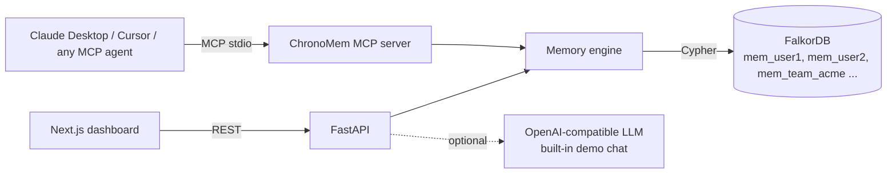

# ChronoMem — memory that knows *when*, *why*, and *who said so*

> Time-aware, contradiction-detecting graph memory for AI agents, built on **FalkorDB** and shipped as an **MCP plugin** for any agent (Claude Desktop, Cursor, Cortex Code, …).

**Graph Hacks tracks:** Track 2 — Agent Memory & Coordination (primary) · Track 3 — Company Brain

---

## The problem

Today's agent memory (Mem0, Zep, MemGPT/Letta, markdown files) is a bag of facts:

| Pain developers report | What happens |
|---|---|
| Memory bloat / stale facts | Old facts pile up; nothing knows "this was true *then*, not now" |
| Silent overwrites | "I'm vegetarian" → "had a steak" — memory just flips, or keeps both |
| One decay rate for everything | Your mood from yesterday weighs as much as your name |
| Wall-clock forgetting | Go on vacation, come back to an agent that forgot you |
| No provenance | "Why do you think that?" — the agent can't say |
| Multi-agent chaos | Two agents write different "facts"; no record of who said what |

## What ChronoMem does

| Feature | How the graph does it |
|---|---|
| **Temporal facts** | Every fact is a node with `valid_from` / `valid_to`. Ask what was believed at any point in time. |
| **Contradiction catch** | Conflicting single-valued facts create a `CONTRADICTS` edge and the agent *asks* instead of overwriting. |
| **Version chains** | Resolving creates `(new)-[:SUPERSEDES]->(old)`; `why_changed` walks the chain with source quotes. |
| **Typed, session-based decay** | identity never fades · preference ~30 sessions · goal ~5 · state ~1. Recall reinforces. |
| **Provenance on everything** | `(Fact)-[:SOURCED_FROM]->(Message)` + `(Agent)-[:ASSERTED]->(Fact)` |
| **Multi-hop recall** | "Where do I work?" → `Acme Labs` → *via Acme Labs* → `located in Mysuru` |
| **What matters most** | `algo.pageRank` over the entity graph = the user's core profile |
| **Multi-tenant** | One isolated FalkorDB graph per user/team (`mem_<id>`) in a single instance |
| **Shared team memory** | Many agents write to `mem_team_*`; cross-agent conflicts surface with who-said-what |
| **Traceable** | Every call returns the exact Cypher it ran; the dashboard shows it step by step |

**Remove FalkorDB and nothing works**: storage, conflict detection, history, recall, ranking and tenancy are all graph queries.

## Architecture



The host agent's own LLM extracts the facts and calls ChronoMem's tools, so **no API key is required**. The engine is the same for MCP and the dashboard.

## Graph data model

```
(:User {id, session_no, last_active})
(:Session {no, started_at})-[:OF]->(:User)
(:Message {id, text, ts, role, session})-[:IN]->(:Session)
(:Entity {name, name_n, type})
(:Fact {id, key, subject, predicate, object, kind, single_valued, status,
        valid_from, valid_to, created_session, last_session, hits, confidence, asserted_by})
(:Agent {name})

(:Entity)-[:HAS_FACT]->(:Fact)-[:ABOUT]->(:Entity)
(:Fact)-[:SOURCED_FROM]->(:Message)        provenance
(:Agent)-[:ASSERTED {ts}]->(:Fact)         who said it
(:Fact)-[:SUPERSEDES {ts}]->(:Fact)        version history
(:Fact)-[:CONTRADICTS {status, ts}]->(:Fact)  pending | kept_new | kept_old | kept_both
(:Entity)-[:RELATED {pred}]->(:Entity)     projection of active facts, used by graph algorithms
```

`Fact.status`: `active | pending | superseded | rejected | archived | forgotten`
`Fact.kind`: `identity | preference | goal | state` (each with its own half-life in sessions)

## Cypher the product depends on

All queries live in [`backend/chronomem/memory.py`](backend/chronomem/memory.py).

**Store a fact with provenance**
```cypher
MERGE (s:Entity {name_n:$s_n}) ON CREATE SET s.name=$s, s.type='thing'
MERGE (o:Entity {name_n:$o_n}) ON CREATE SET o.name=$o, o.type='thing'
CREATE (f:Fact {id:$id, key:$key, subject:$s, predicate:$p, object:$o, kind:$kind,
                status:$status, valid_from:$t, last_session:$sess, hits:1, asserted_by:$by, ...})
CREATE (s)-[:HAS_FACT]->(f)-[:ABOUT]->(o)
WITH s, o, f
MATCH (m:Message {id:$mid}) CREATE (f)-[:SOURCED_FROM]->(m)
MERGE (a:Agent {name:$by}) CREATE (a)-[:ASSERTED {ts:$t}]->(f)
```

**Detect a contradiction (or reinforce a duplicate instead of bloating)**
```cypher
MATCH (f:Fact {key:$key}) WHERE f.status = 'active' RETURN f
// same object  -> reinforce:  SET f.hits = f.hits + 1, f.last_session = $sess
// other object -> flag:
MATCH (n:Fact {id:$new}), (o:Fact {id:$old})
CREATE (n)-[:CONTRADICTS {status:'pending', ts:$t}]->(o)
```

**Supersede (close the validity window)**
```cypher
MATCH (n:Fact {id:$new}), (o:Fact {id:$old})
SET o.valid_to=$t, o.status='superseded', n.status='active', n.valid_from=$t
CREATE (n)-[:SUPERSEDES {ts:$t}]->(o)
```

**Multi-hop recall** (facts matching the query + facts about the entities they point to)
```cypher
MATCH (f:Fact) WHERE f.status = 'active'
  AND any(t IN $toks WHERE f.subject_n CONTAINS t OR f.predicate_n CONTAINS t OR f.object_n CONTAINS t)
OPTIONAL MATCH (f)-[:ABOUT]->(:Entity)-[:HAS_FACT]->(h:Fact) WHERE h.status = 'active'
OPTIONAL MATCH (f)-[:SOURCED_FROM]->(m:Message)
RETURN f, collect(DISTINCT h) AS hops, collect(DISTINCT m.text) AS src
```

**Time travel: what did the agent believe at time T?**
```cypher
MATCH (f:Fact)
WHERE f.valid_from <= $as_of AND (f.valid_to IS NULL OR f.valid_to > $as_of)
  AND f.status IN ['active','superseded']
RETURN f
```

**Why did this change?**
```cypher
MATCH (f:Fact) WHERE f.key IN $keys
OPTIONAL MATCH (f)-[:SOURCED_FROM]->(m:Message)
OPTIONAL MATCH (f)-[:SUPERSEDES]->(prev:Fact)
RETURN f, collect(DISTINCT m.text) AS src, prev.object AS replaced
ORDER BY f.valid_from
```

**Pending contradictions with both sides' sources**
```cypher
MATCH (n:Fact)-[c:CONTRADICTS {status:'pending'}]->(o:Fact)
OPTIONAL MATCH (n)-[:SOURCED_FROM]->(mn:Message)
OPTIONAL MATCH (o)-[:SOURCED_FROM]->(mo:Message)
RETURN n, o, collect(DISTINCT mn.text), collect(DISTINCT mo.text)
```

**Core profile: graph algorithm as an agent tool**
```cypher
CALL algo.pageRank('Entity', 'RELATED') YIELD node, score
WITH node, score WHERE node.name_n <> 'user'
MATCH (node)-[:RELATED]-()
WITH DISTINCT node, score
RETURN node.name, score ORDER BY score DESC LIMIT $lim
```

**Decay** is computed per fact: `strength = 0.5 ^ (sessions_since_last_use / half_life(kind) * (1 + 0.25*(hits-1)))`. Facts below 0.15 are hidden from recall, and below 0.05 the sweep archives them.

## MCP tools

| Tool | Purpose |
|---|---|
| `begin_session` | start a conversation (decay is measured in sessions) |
| `remember(subject, predicate, object, kind, source, single_valued, mode, asserted_by)` | store a fact; returns `contradiction` + an `ask_user` question when it conflicts |
| `resolve(fact_id, keep=new\|old\|both)` | settle a contradiction after asking the user |
| `recall(query, as_of?, show_trace?)` | multi-hop recall, optionally at a point in time, optionally with Cypher trace |
| `why_changed(topic)` | version history with source quotes |
| `contradictions()` | pending conflicts |
| `core_profile()` | PageRank: what matters most |
| `forget(fact_id)` | the user asks to forget something |

The server ships `instructions` telling the host agent when to call each tool.

## Run it locally

Prereqs: Docker, Python 3.11+ with [uv](https://docs.astral.sh/uv/), Node 20+.

```bash
# 1. FalkorDB
docker run -d --name falkordb -p 6379:6379 -p 3001:3000 falkordb/falkordb:latest

# 2. API
cd backend
cp .env.example .env          # optional: add LLM_API_KEY to enable dashboard chat
uv sync
uv run chronomem-api          # http://localhost:8000/docs

# 3. Dashboard
cd ../web
npm install
npm run dev                   # http://localhost:3000
```

Then click **Demo: personal** or **Demo: team brain** in the dashboard.

Or run everything with one command: `docker compose up --build`.

### Tests
```bash
cd backend
uv run python tests/smoke.py       # engine end-to-end against FalkorDB
uv run python tests/mcp_client.py  # MCP server over stdio, like Claude Desktop
```

## Plug into your agent

**Claude Desktop** (`claude_desktop_config.json`), **Cursor** (`.cursor/mcp.json`) or any MCP client:
```json
{
  "mcpServers": {
    "chronomem": {
      "command": "uv",
      "args": ["--directory", "/ABSOLUTE/PATH/chronomem/backend", "run", "chronomem-mcp"],
      "env": { "CHRONOMEM_USER": "nandan", "FALKORDB_HOST": "localhost", "FALKORDB_PORT": "6379" }
    }
  }
}
```
The same memory now follows you across every MCP-capable tool, and the dashboard shows it live.

## Demo script

1. **Demo: personal** loads 30 days of Nandan's memory (moved Bengaluru → Mysuru, building ChronoMem…).
2. **Conflicts (1):** *vegetarian* vs *"Had chicken biryani today"*, with both source quotes. Click **Keep new**; the graph draws a `SUPERSEDES` edge.
3. **History → "lives":** Bengaluru → Mysuru, with dates and quotes.
4. **Time travel slider** back three weeks: the agent's beliefs as they were then.
5. **Recall → "work":** multi-hop `Acme Labs → located in Mysuru`. The **Trace** tab shows the Cypher.
6. **New session** ×2: the "stressed about exams" mood fades, identity stays.
7. **Demo: team brain:** slack-agent says Priya owns billing-service, jira-agent says Rahul, and ChronoMem flags it with who said what. Recall "checkout" walks `checkout-web → billing-service → owner / ADR / postgres-main`.
8. Same tools from Claude Desktop via MCP.

## Tech

FalkorDB · Python · FastAPI · MCP (FastMCP) · Next.js 16 · React 19 · Tailwind v4 · react-force-graph

## AI assistance disclosure

Built with help from an AI coding assistant (Snowflake Cortex Code) for scaffolding and boilerplate. The graph model, memory semantics (temporal validity, contradiction flow, typed session decay), the queries and the architecture were designed, reviewed and tested by the team.

## License

MIT
